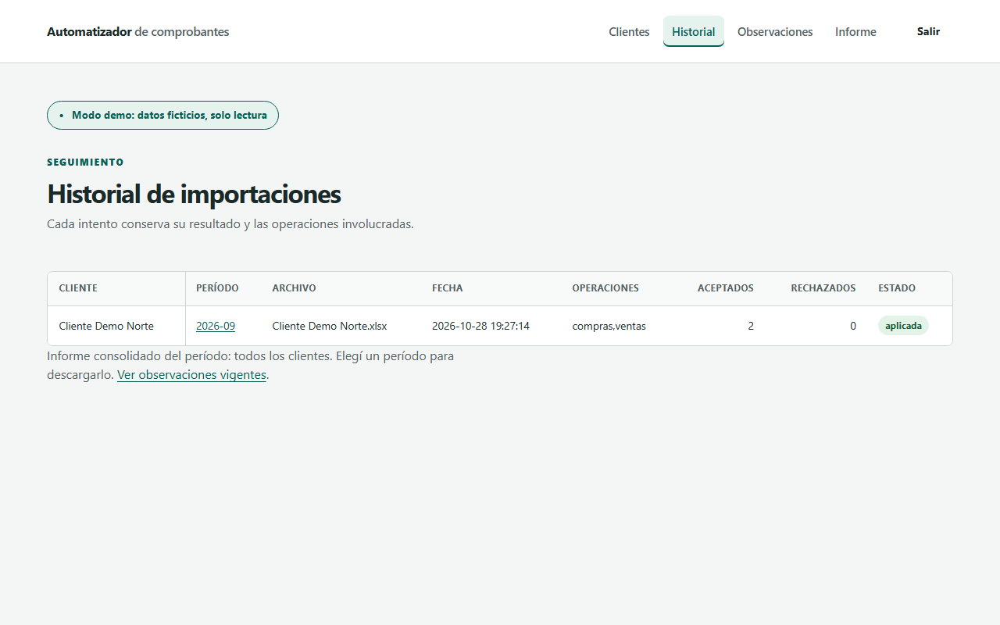
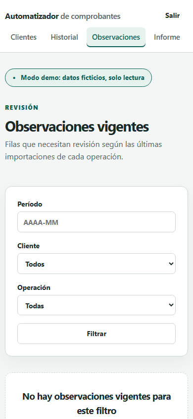
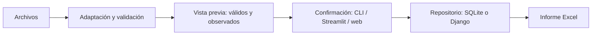

# Automatizador de comprobantes e informes de IVA

Herramienta para estudios contables argentinos: revisa ventas y compras y genera informes mensuales en Excel.

[](https://github.com/SantinelliGabriel/automatizador-reportes/actions/workflows/tests.yml) [](https://codecov.io/gh/SantinelliGabriel/automatizador-reportes) [](https://www.python.org/) [](https://automatizador-reportes-kqvtruqnyz7gwzj47ex7is.streamlit.app/) [](LICENSE)


[English](README.en.md)

## Índice

[Problema](#qué-problema-resuelve) · [Prueba rápida](#probalo-en-2-minutos) · [Capacidades](#qué-incluye) · [Flujo](#cómo-funciona) · [Diseño](#decisiones-de-diseño) · [Estado](#estado-y-límites) · [Documentación](#documentación) · [Desarrollo](#desarrollo) · [Estructura](#estructura) · [Privacidad](#datos-y-privacidad) · [Licencia](#licencia)

## Qué problema resuelve

Un estudio contable recibe archivos de varios clientes y necesita revisar comprobantes antes de consolidar el mes.
La herramienta conserva las filas aceptadas y reúne las observadas con el motivo para facilitar su corrección.

## Probalo en 2 minutos

[Abrir la demo Streamlit con datos ficticios](https://automatizador-reportes-kqvtruqnyz7gwzj47ex7is.streamlit.app/), sin instalación ni carga de archivos.
Para ejecutar el ejemplo desde un clon: Python 3.11 a 3.13, probados en CI. [Instalación detallada](docs/instalacion.md).

### PowerShell

```powershell
python -m venv .venv
.\.venv\Scripts\Activate.ps1
python -m pip install -e .
automatizador --period 2026-09
```

### macOS y Linux

```bash
python3 -m venv .venv
source .venv/bin/activate
python -m pip install -e .
automatizador --period 2026-09
```
La CLI lee `ejemplos/Cliente Demo Norte.xlsx` y genera `reporte_iva.xlsx` y `comprobantes.db`.

## Qué incluye

| Capacidad | Alcance |
| --- | --- |
| Importación y validación | Alias, CUIT, período, duplicados, moneda extranjera y varias alícuotas |
| Informes Excel | Comprobantes, detalle IVA, resúmenes y observaciones |
| ARCA y Holistor | Adaptadores de exportaciones y mapeos configurables |
| Conciliación bancaria | Coincidencias sugeridas para revisión |
| Vencimientos | Consulta por terminación de CUIT en un calendario aportado |

### Interfaces

| Interfaz | Alcance |
| --- | --- |
| CLI | Comando instalable para archivos, carpetas e historial |
| Streamlit | Importación local, conciliación, agenda y demo sintética |
| Web Django | Carga segura, vista previa, historial, observaciones, informe consolidado y modo demo |

### Capturas con datos ficticios

| Historial | Observaciones en móvil |
| --- | --- |
|  |  |

La [guía web](docs/web.md) contiene todas las capturas y los pasos para ejecutarla.

## Cómo funciona


[Arquitectura y contrato de persistencia](docs/arquitectura.md).

## Decisiones de diseño

- Importes en centavos enteros y cálculos con Decimal; [detalle](docs/diseno.md#dinero-y-decimales).
- Alícuota y tipo de cambio en texto decimal canónico, nunca float en la base; [detalle](docs/diseno.md#dinero-y-decimales).
- Reemplazo por cliente, período y operación; [detalle](docs/diseno.md#alcance-del-reemplazo).
- Filas observadas en lugar de abortar el lote completo; [detalle](docs/diseno.md#filas-observadas-e-historial).
- Contrato con repositorios SQLite y Django; [detalle](docs/diseno.md#persistencia-e-informes).
- Observaciones vigentes desde la última aplicación y los intentos posteriores; [detalle](docs/diseno.md#filas-observadas-e-historial).
- Vista previa web con token de un solo uso y vencimiento; [detalle](docs/diseno.md#vista-previa-web).

## Estado y límites

Versión [0.2.0](CHANGELOG.md), proyecto personal de portfolio y apoyo a la revisión contable.
No reemplaza la validación profesional ni presenta declaraciones. No hay conexión directa a ARCA ni Holistor.
La web Django se ejecuta en local; no se ofrece como servicio público.
Al migrar una base SQLite existente se crea un respaldo previo según su versión de origen.
La CLI y Streamlit informan su ubicación; se debe conservar hasta revisar el resultado. [Guía de migración](docs/migracion.md).

## Documentación

[Instalación](docs/instalacion.md) · [Web Django](docs/web.md) · [Diseño](docs/diseno.md) · [Arquitectura](docs/arquitectura.md) · [Migración](docs/migracion.md).
[Adaptadores](docs/adaptadores.md) · [Conciliación](docs/conciliacion.md) · [Vencimientos](docs/vencimientos.md) · [Demo Streamlit](docs/demo-streamlit.md).

## Desarrollo

Controles del [CI](https://github.com/SantinelliGabriel/automatizador-reportes/actions/workflows/tests.yml); [preparación de variables](docs/instalacion.md#entorno-para-controles-de-desarrollo).
```bash
python -m pip install -e ".[dev,web]"
ruff check .
coverage run -m unittest discover -s tests -v
coverage report -m
coverage xml
```

### Comprobaciones Django

```bash
python web/manage.py check
python web/manage.py check --deploy
python web/manage.py makemigrations --check --dry-run
python web/manage.py collectstatic --noinput
```
El CI repite `check --deploy` con modo demo activo y envía cobertura a Codecov en Linux.
La suite incluye la comprobación de enlaces e imágenes de la documentación.

## Estructura

```text
automatizador/   Núcleo, CLI, Streamlit, adaptadores y repositorio SQLite
web/             Configuración Django, modelos, repositorio, pantallas y estáticos
tests/           Suite y fixtures sintéticos, incluido tests/fixtures/arca/
ejemplos/, datos_demo/   Entradas y salidas sintéticas
docs/, .github/, .streamlit/   Guías e imágenes; CI y configuración Streamlit
```
Raíz: `main.py`, `interfaz.py`, `generar_datos_demo.py`, `demo.py`, `holistor_mapping.example.json`, `pyproject.toml`, `requirements.txt`, `.gitignore`, `AGENTS.md`, `CHANGELOG.md`, `LICENSE`, `README.md` y `README.en.md`. [Responsabilidades](docs/arquitectura.md#archivos-de-la-raíz).

## Datos y privacidad

Solo se incluyen datos sintéticos. `.gitignore` excluye `*.db`, `*.sqlite3`, `db.sqlite3`, `reporte_*.xlsx`, `datos/`, `resultados/`, `media/` y `automatizador-previews/`.
Las vistas previas web usan por defecto un directorio temporal fuera del repositorio; no se deben colocar bajo rutas servidas.

## Licencia

Distribuido bajo [MIT](LICENSE). [Cambios por versión](CHANGELOG.md).
