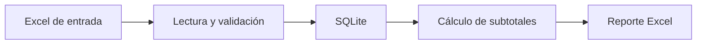

# Automatizador de reportes de ventas

[](https://github.com/SantinelliGabriel/automatizador-reportes/actions/workflows/tests.yml)

Aplicación de consola en Python que valida ventas desde Excel, las guarda en SQLite y genera un reporte Excel listo para compartir.

## Flujo



## Funcionalidades

- Comprueba columnas obligatorias, celdas vacías, cantidades y precios.
- Redondea precios a dos decimales con regla de mitad hacia arriba y calcula los importes usando centavos enteros.
- Reemplaza las ventas de la base en cada ejecución. Las filas repetidas del archivo de entrada se conservan.
- Genera un Excel con subtotales, total general, filtros, encabezados formateados y columnas ajustadas.
- Publica el reporte y confirma los cambios de SQLite de forma coordinada; ante un error, restaura el reporte anterior y revierte la transacción.
- Incluye pruebas unitarias y un flujo de integración continua en Linux y Windows.

## Ejemplo de salida

| producto | unidades | precio_unitario | total |
| --- | ---: | ---: | ---: |
| Teclado | 5 | $12.000,00 | $60.000,00 |
| Mouse | 8 | $7.500,00 | $60.000,00 |
| **TOTAL GENERAL** | **13** |  | **$120.000,00** |

## Requisitos

- Python 3.11
- Dependencias listadas en `requirements.txt`
- Un Excel `.xlsx` con las columnas `producto`, `unidades` y `precio_unitario`

## Instalación

```powershell
python -m venv .venv
.\.venv\Scripts\python.exe -m pip install -r requirements.txt
```

En macOS o Linux, usar `./.venv/bin/python -m pip install -r requirements.txt`.

## Ejecución

Con los archivos predeterminados (`ventas_entrada.xlsx`, `reporte_ventas.xlsx` y `ventas.db`):

```powershell
.\.venv\Scripts\python.exe main.py
```

Se pueden elegir las tres rutas desde la consola:

```powershell
.\.venv\Scripts\python.exe main.py `
  --input datos/ventas.xlsx `
  --output resultados/reporte.xlsx `
  --database resultados/ventas.db
```

También se pueden consultar las opciones con `python main.py --help`.

## Pruebas

```powershell
.\.venv\Scripts\python.exe -m unittest discover -v
```

GitHub Actions ejecuta la misma suite en cada push y pull request, tanto en Ubuntu como en Windows.

## Estructura

- `main.py`: argumentos de consola y coordinación del proceso.
- `validaciones.py`: contrato y validaciones de los datos de entrada.
- `database.py`: persistencia, migración de SQLite y consultas.
- `reportes.py`: construcción del reporte y formato Excel.
- `config.py`: rutas predeterminadas.
- `test_main.py`: pruebas de validación, SQLite y generación del archivo.

## Orden de mejoras del proyecto

1. **Pruebas y CI:** suite automatizada en Ubuntu y Windows al hacer push o abrir un pull request. Implementado.
2. **Presentación:** README con flujo, ejemplo de salida, instalación, ejecución y limitaciones. Implementado.
3. **Uso flexible:** rutas de entrada, salida y base de datos configurables desde la consola. Implementado.
4. **Confiabilidad:** responsabilidades separadas para construir reportes, importes calculados en centavos y migración de la base existente. Implementado.
5. **Entrada flexible:** normalizar encabezados y permitir mapear nombres alternativos.
6. **Trazabilidad:** conservar un historial de importaciones además del estado actual.
7. **Distribución:** empaquetar el programa para facilitar su instalación.

## Limitaciones actuales

- Los encabezados deben coincidir exactamente con `producto`, `unidades` y `precio_unitario`.
- Cada ejecución reemplaza el contenido de la tabla de ventas; no conserva un historial de importaciones.
- La salida es un archivo Excel, no una aplicación web ni un servicio de reportes programados.
