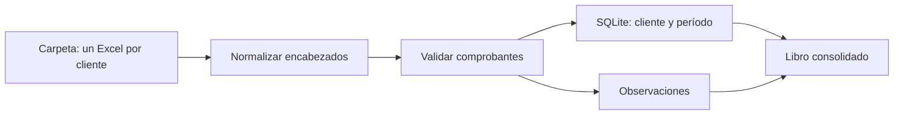

# Automatizador de comprobantes e informes de IVA

[](https://github.com/SantinelliGabriel/automatizador-reportes/actions/workflows/tests.yml)

Herramienta de consola en Python para importar comprobantes de ventas y compras desde Excel, revisar inconsistencias, conservar cargas por cliente y período en SQLite y generar un libro consolidado para revisión.

> Proyecto de portfolio y apoyo a la revisión. No presenta declaraciones ni reemplaza la validación profesional de la información.

## Qué resuelve

Un estudio contable recibe archivos de varios clientes y necesita detectar comprobantes incompletos o inconsistentes antes de consolidar la información mensual. La herramienta valida cada fila, registra los comprobantes aceptados y concentra las filas observadas con su motivo para facilitar la corrección.

## Flujo



## Funcionalidades

- Importa comprobantes de ventas y compras con fecha, tipo, punto de venta, número, CUIT, razón social, neto gravado, alícuota, IVA, importes no gravados/exentos, percepciones y total.
- Acepta alias conocidos de encabezados en español e inglés, ignorando mayúsculas, acentos, espacios y guiones.
- Comprueba el formato y dígito de control del CUIT, tipos de comprobante, alícuotas, fechas del período, conciliación de importes y duplicados.
- Envía las filas rechazadas a la hoja `Observaciones`, junto con el número de fila y los motivos.
- Procesa una carpeta con un Excel por cliente. Al volver a importar, reemplaza únicamente los comprobantes de ese cliente y período; el resto de la base se conserva.
- Si no se puede leer un archivo o todas sus filas se rechazan, conserva la importación previa de ese cliente/período y deja una observación.
- Guarda las cargas y los comprobantes aceptados en SQLite.
- Genera hojas `Comprobantes`, `Resumen por cliente`, `IVA por alícuota` y `Observaciones`.
- Considera las notas de crédito como importes que reducen los resúmenes; mantiene sus importes originales en el detalle.
- Incluye lectores para Excel/CSV estándar, exportaciones de Mis Comprobantes ARCA y plantillas Holistor con mapeo editable.
- Concilia movimientos bancarios firmados con comprobantes por importe y fecha, asignando cada movimiento una sola vez.
- Incluye una agenda por CUIT que lee un calendario oficial actualizado y avisa vencimientos cercanos.
- Ofrece una interfaz local en Streamlit para importar, conciliar y consultar vencimientos.
- Incluye archivos ficticios generables para probar el flujo sin usar datos de clientes.

Las alícuotas admitidas son 0 %, 2,5 %, 5 %, 10,5 %, 21 % y 27 %, de acuerdo con la tabla de alícuotas publicada por [ARCA para Libro IVA Digital](https://arca.gob.ar/libro-iva-digital/documentos/Libro-IVA-Digital-Tablas-del-Sistema.pdf). La inclusión en la tabla no determina por sí sola qué tasa corresponde a una operación: eso depende de su tratamiento fiscal.

## Formato de entrada

Cada archivo Excel, CSV o TXT de la carpeta representa un cliente. El nombre del archivo, sin extensión, se usa como nombre del cliente en la base. Las columnas requeridas son:

| Columna | Descripción |
| --- | --- |
| `fecha` | Fecha del comprobante |
| `tipo_comprobante` | Por ejemplo `A`, `B`, `C`, `NC A` o `ND B` |
| `punto_venta`, `numero` | Identificación numérica del comprobante |
| `cuit`, `razon_social` | Identificación y nombre fiscal de la contraparte |
| `neto_gravado`, `alicuota`, `iva` | Base imponible y datos de IVA |
| `no_gravado_exento`, `percepciones`, `total` | Otros componentes y total del comprobante |
| `operacion` | `ventas` o `compras`; si se omite, se considera `ventas` |

Para revisar una plantilla se pueden generar dos archivos de clientes ficticios:

```powershell
python generar_datos_demo.py
```

Los CUIT de demostración tienen dígito de control calculado, pero son datos sintéticos y no se debe inferir que estén libres de asignación en los registros reales.

## Instalación y uso

Requiere Python 3.11 o posterior. Las dependencias están en `requirements.txt`.

```powershell
python -m venv .venv
.\.venv\Scripts\python.exe -m pip install -r requirements.txt
.\.venv\Scripts\python.exe main.py --period 2026-09
```

El uso predeterminado toma los Excel de `datos_demo`, guarda la base en `comprobantes.db` y crea `reporte_iva.xlsx`.

Para indicar rutas propias:

```powershell
python main.py `
  --input datos/clientes `
  --output resultados/reporte.xlsx `
  --database resultados/comprobantes.db `
  --period 2026-09
```

También se puede pasar un solo archivo Excel en `--input`. Consultá cargas previas con:

```powershell
python main.py --history
```

### Adaptadores ARCA y Holistor

Para los archivos descargados de `Mis Comprobantes`, elegí el formato e indicá si son emitidos o recibidos:

```powershell
python main.py --input compras.csv --source arca --operation compras --period 2026-09
```

La exportación de ARCA agrega algunos importes. Si no se puede obtener una única alícuota o separar moneda, otros tributos y percepciones, la fila se deriva a `Observaciones` para control en el comprobante fuente.

Holistor distribuye modelos de importación asociados a sus productos y versiones. El adaptador acepta Excel/CSV con encabezados mapeables y `.prn` configurados mediante JSON. La [guía oficial de Holistor](https://soporte.holistor.com.ar/portal/es/kb/articles/iva-importacion-de-mis-comprobantes-emitidos) describe el modelo HWVTARCA/HWVEXARCA para copiar los datos exportados desde ARCA a una plantilla y guardar `.prn`; el archivo de modelo requiere acceso al centro de soporte. No se supone un ancho fijo universal.

La configuración editable se muestra en `holistor_mapping.example.json`. Para el `.prn`, completá `anchos_prn` y `columnas_prn` usando el diseño de registro entregado para tu instalación.

### Conciliación

La interfaz permite seleccionar las columnas de fecha e importe de un extracto CSV/Excel. Los importes deben venir firmados: créditos bancarios positivos para ventas y débitos negativos para compras. Se busca una coincidencia uno a uno con tolerancia de importe y días configurable. Descargá el resultado para revisar partidas pendientes.

### Vencimientos

La agenda cruza un CSV/Excel con columnas `impuesto`, `periodo`, `terminacion_cuit` y `fecha_vencimiento` contra un CSV/Excel de clientes con `cliente` y `cuit`. El archivo incluido contiene el cronograma de IVA de octubre de 2026 publicado en la [agenda de ARCA](https://arca.gob.ar/); cargá el cronograma oficial actualizado cada mes, porque las fechas dependen del calendario vigente y pueden cambiar.

### Interfaz

```powershell
python -m streamlit run interfaz.py
```

La aplicación se ejecuta localmente y guarda los datos importados en la base SQLite elegida en la barra lateral.

La interfaz funciona en el entorno local. Para publicarla en un hosting hay que definir autenticación, almacenamiento privado y separación de datos por estudio.

## Estructura

- `main.py`: CLI, proceso por cliente y generación del libro.
- `validaciones.py`: alias, reglas de validación y motivos de rechazo.
- `database.py`: esquema SQLite e importación por cliente/período.
- `reportes.py`: resúmenes y formato del Excel.
- `generar_datos_demo.py`: creación de archivos sintéticos.
- `adaptadores.py`: lectura de ARCA, Holistor y formatos estándar.
- `conciliacion.py`: cruce de bancos con comprobantes.
- `vencimientos.py`: agenda basada en fechas oficiales cargadas.
- `interfaz.py`: aplicación Streamlit local.
- `test_main.py`: pruebas automatizadas.

## Próximas mejoras

1. Adaptadores ARCA/Holistor, conciliación inicial, agenda e interfaz local. Implementados con revisión de excepciones y mapeos configurables.
2. Reportes separados de débito/crédito fiscal y gráficos.
3. Pruebas con archivos anonimizados de distintas versiones de ARCA y Holistor.
4. Exportación a Libro IVA Digital solo después de verificar el [diseño vigente de registros y tablas de ARCA](https://arca.gob.ar/libro-iva-digital/documentos/libro-iva-digital-diseno-registros.pdf), que puede cambiar.

## Datos y privacidad

No incluyas CUIT, razones sociales, comprobantes ni importes reales en el repositorio. Los archivos de `datos_demo` se generan con datos sintéticos. La base local y los reportes generados están excluidos del control de versiones.
