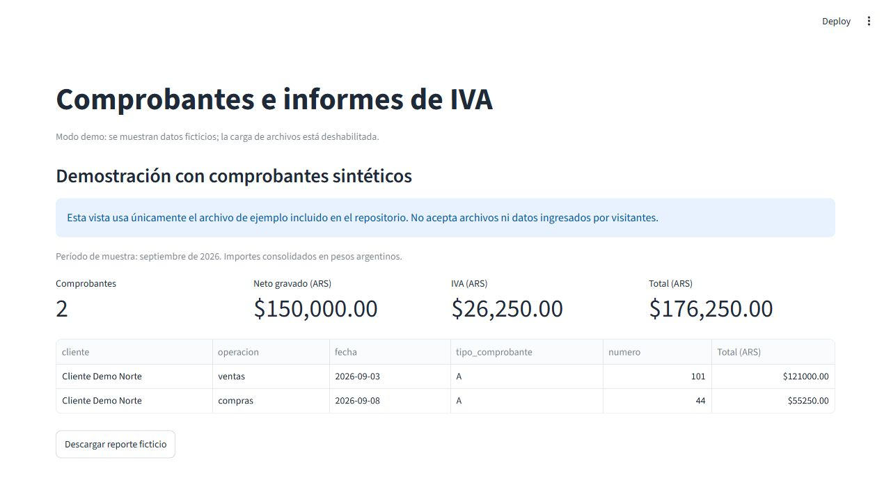
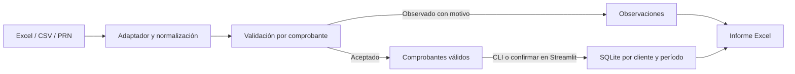

# Automatizador de comprobantes e informes de IVA

[](https://github.com/SantinelliGabriel/automatizador-reportes/actions/workflows/tests.yml) [](https://codecov.io/gh/SantinelliGabriel/automatizador-reportes) [](https://www.python.org/) [](https://automatizador-reportes-kqvtruqnyz7gwzj47ex7is.streamlit.app/)

**English summary:** A Python tool for validating accounting vouchers and producing monthly VAT reports.<br>
It combines source adapters, SQLite history, bank reconciliation, and a synthetic Streamlit demo.

**Estado:** proyecto personal de portfolio · **Versión declarada:** 0.1.0

Herramienta para revisar comprobantes de ventas y compras, registrar observaciones y producir informes mensuales en Excel.



> Proyecto de apoyo a la revisión. No presenta declaraciones ni reemplaza la validación profesional.

## Índice

[Problema](#problema) · [Funcionalidades](#funcionalidades) · [Demo](#demo) · [Uso](#instalación-y-uso) · [Flujo](#flujo) · [Diseño](#decisiones-de-diseño) · [Limitaciones](#limitaciones-y-próximos-pasos) · [Desarrollo](#desarrollo)

## Problema

Un estudio contable recibe archivos de varios clientes y necesita revisar comprobantes antes de consolidar cada período. El programa valida filas, conserva las aceptadas y reúne las observadas con el motivo.

## Funcionalidades

### Importación y validación
- Procesa ventas y compras; valida CUIT, período, tipo, alícuotas, importes y duplicados.
- Reconoce alias de encabezados y conserva comprobantes con varias alícuotas cuando el origen incluye el desglose.

### Informes
- Produce hojas de comprobantes, detalle de IVA, resúmenes por cliente y alícuota y observaciones.
- Conserva historial por cliente y período. [Ver libro de ejemplo](ejemplos/salida.xlsx).


### Integraciones
- Importa archivos estándar, exportaciones de Mis Comprobantes ARCA y plantillas Holistor.
- Sugiere coincidencias para extractos bancarios y calcula fechas usando un calendario de vencimientos aportado por el usuario.

### Interfaces
- CLI instalable, interfaz Streamlit local y demo con datos sintéticos sin carga de archivos.

## Demo

**Demo en vivo:** [Abrir la aplicación](https://automatizador-reportes-kqvtruqnyz7gwzj47ex7is.streamlit.app/)

Ejecución local en PowerShell, macOS o Linux:
```
streamlit run demo.py
```
Guía de [configuración y despliegue](docs/demo-streamlit.md).

## Instalación y uso

Requiere Python 3.11 o posterior. PowerShell:
```powershell
python -m venv .venv
.\.venv\Scripts\Activate.ps1
python -m pip install -e .
automatizador --period 2026-09
```
macOS o Linux:
```bash
python3 -m venv .venv
source .venv/bin/activate
python -m pip install -e .
automatizador --period 2026-09
```

Para procesar una carpeta con rutas explícitas, PowerShell:
```powershell
automatizador `
  --input datos/clientes `
  --output resultados/reporte.xlsx `
  --database resultados/comprobantes.db `
  --period 2026-09
```
macOS o Linux:
```bash
automatizador \
  --input datos/clientes \
  --output resultados/reporte.xlsx \
  --database resultados/comprobantes.db \
  --period 2026-09
```
Más detalles de [adaptadores ARCA/Holistor](docs/adaptadores.md).

## Flujo



## Decisiones de diseño
- Usa `Decimal` para redondear a dos decimales y guarda importes en SQLite como centavos enteros.
- Reimportar reemplaza solo el mismo cliente y período, dentro de una transacción; el historial y otros períodos se conservan.
- Las filas rechazadas quedan observadas con el motivo, sin abortar el lote completo.
- Para moneda extranjera usa el `tipo_cambio` informado en el archivo; no consulta una cotización externa.

## Limitaciones y próximos pasos
- No hay conexión directa a ARCA ni Holistor; detalles en [adaptadores](docs/adaptadores.md).
- La [conciliación](docs/conciliacion.md) sugiere coincidencias para revisión; la [agenda](docs/vencimientos.md) requiere mantener un calendario.
- La demo pública usa el ejemplo sintético y oculta la carga. La URL pública debe comprobarse en el servicio.
- Próximos pasos: ampliar fixtures sintéticos por versión, sumar reportes de IVA y cubrir más variantes de conciliación.

## Desarrollo

Instalación y controles de calidad, desde la raíz del repo:
```powershell
python -m pip install -e ".[dev]"
ruff check .
coverage run -m unittest discover -s tests -v
```
```bash
python -m pip install -e ".[dev]"
ruff check .
coverage run -m unittest discover -s tests -v
```
GitHub Actions ejecuta los controles en Linux y Windows.

## Estructura

```text
automatizador/                  Paquete: lógica, CLI, adaptadores e interfaz
tests/                          Pruebas por módulo
tests/fixtures/arca/             CSV sintético de Mis Comprobantes
ejemplos/                       Entradas, salida y calendario sintéticos
datos_demo/                     Archivos sintéticos de demostración
docs/                           Guías técnicas e imágenes
demo.py                         Entrada Streamlit de la demo pública
main.py                         Entrada de compatibilidad para la CLI
interfaz.py                     Entrada de compatibilidad para Streamlit
generar_datos_demo.py           Generador de ejemplos sintéticos
holistor_mapping.example.json   Mapeo de referencia para Holistor
pyproject.toml                  Metadatos, dependencias y comandos
CHANGELOG.md                    Historial de versiones
LICENSE                         Licencia MIT
```

## Datos y privacidad

Los ejemplos incluidos son sintéticos. `.gitignore` excluye las bases SQLite y los informes predeterminados `reporte_ventas.xlsx` y `reporte_iva.xlsx`; otras rutas de salida no se excluyen automáticamente.

## Licencia

Distribuido bajo la [licencia MIT](LICENSE). [Cambios por versión](CHANGELOG.md).
