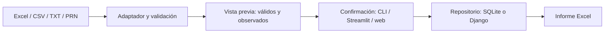

# Arquitectura

## Flujo de datos

Los adaptadores leen archivos y normalizan encabezados. Las validaciones separan comprobantes aceptados y observaciones. `previsualizar` construye un plan sin modificar la base; `confirmar_importacion` lo guarda por medio de un repositorio. `generar_informe` consulta ese repositorio y arma el Excel. La CLI coordina ambas operaciones; Streamlit y Django permiten revisión antes de confirmar.

## Módulos

| Módulo | Responsabilidad |
| --- | --- |
| `adaptadores.py`, `validaciones.py` | Lectura, alias y reglas por comprobante |
| `clientes.py`, `decimales.py` | Claves de cliente y representación decimal |
| `procesamiento.py`, `lotes.py` | Previsualización, conflictos, confirmación e informe |
| `repositorio.py`, `database.py` | Contrato, SQLite y migraciones |
| `vigencia.py`, `reportes.py` | Observaciones vigentes y resúmenes |
| `conciliacion.py`, `vencimientos.py` | Comparación bancaria y calendario |
| `cli.py`, `interfaz.py` | Consola y Streamlit |
| `web/comprobantes/` | Modelos, repositorio Django, carga segura y pantallas |

## Contrato de persistencia

`RepositorioComprobantes` declara:

| Método | Entrada | Salida |
| --- | --- | --- |
| `reemplazar_periodos` | Lista de diccionarios de importación | Lista de IDs |
| `consultar_comprobantes` | Período opcional | DataFrame |
| `consultar_importaciones` | Sin argumentos | DataFrame con estado derivado |
| `consultar_observaciones` | Período e ID de importación opcionales | DataFrame |

Cada diccionario de guardado incluye cliente, período, archivo, comprobantes y rechazados como DataFrames, indicador de aplicación y SHA-256. `RepositorioLotes` prepara las reglas compartidas antes del backend. `RepositorioSQLite` usa una ruta de base; `RepositorioDjango` usa los modelos Cliente, Importacion, Comprobante, DetalleAlicuota y Observacion. Las consultas conservan columnas, tipos y orden compatibles, cubiertos por la suite de contrato.

El núcleo no importa Django. La CLI y Streamlit usan SQLite; la web usa Django. El esquema SQLite del núcleo y las migraciones Django son independientes; [migración](migracion.md) detalla el primero.

## Archivos de la raíz

`main.py`, `interfaz.py` y `generar_datos_demo.py` son entradas de compatibilidad. `demo.py` inicia la demo Streamlit. `pyproject.toml` declara comandos, metadatos y dependencias; `requirements.txt` instala el proyecto para Streamlit. `holistor_mapping.example.json` es la plantilla de mapeo. `.github/workflows/tests.yml`, `.gitignore`, `AGENTS.md`, `CHANGELOG.md`, `LICENSE` y ambos README completan configuración y documentación pública.

[Volver al README](../README.md)
