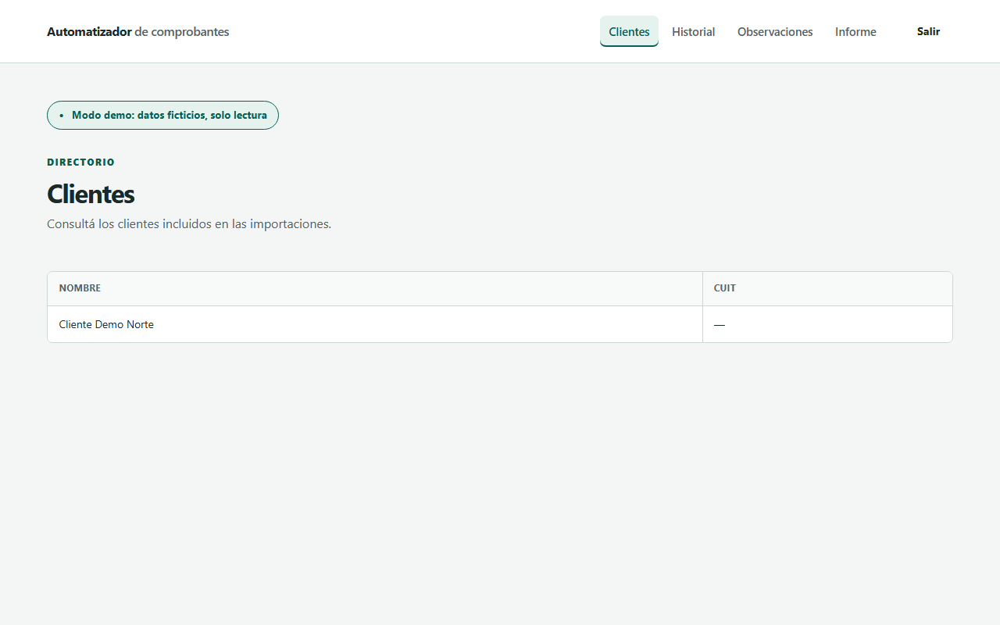
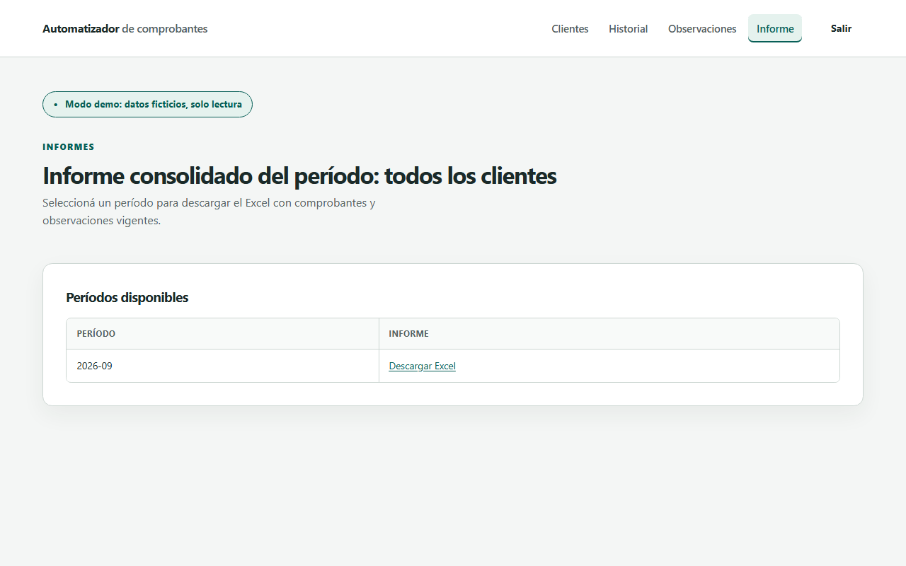

# Interfaz web Django

La web local permite login, alta de clientes, carga segura, vista previa y confirmación, historial con estado, observaciones vigentes y descarga del informe consolidado para todos los clientes del período. Requiere la dependencia opcional Django; la CLI y Streamlit no la requieren. No se ofrece como servicio público.

## Instalación

Crear y activar un entorno virtual desde la raíz según [instalación](instalacion.md). Después:

```bash
python -m pip install -e ".[web]"
```

## Inicio en PowerShell

```powershell
$env:DJANGO_DEBUG = "1"
$env:DJANGO_ALLOWED_HOSTS = "127.0.0.1,localhost"
$env:DJANGO_SECRET_KEY = (& python -c "import secrets; print(secrets.token_urlsafe(64))")
python web/manage.py migrate
python web/manage.py createsuperuser
python web/manage.py runserver 127.0.0.1:8000
```

## Inicio en bash y zsh

```bash
export DJANGO_DEBUG=1 DJANGO_ALLOWED_HOSTS=127.0.0.1,localhost
export DJANGO_SECRET_KEY="$(python -c 'import secrets; print(secrets.token_urlsafe(64))')"
python web/manage.py migrate
python web/manage.py createsuperuser
python web/manage.py runserver 127.0.0.1:8000
```

`createsuperuser` solicita las credenciales; la contraseña no muestra caracteres ni asteriscos. El acceso está en `http://127.0.0.1:8000/login/`. El servidor se detiene con Ctrl+C.

## Configuración y carga

`DJANGO_DEBUG=1` habilita desarrollo local. Fuera de ese modo son obligatorias una `DJANGO_SECRET_KEY` privada y la lista de dominios de `DJANGO_ALLOWED_HOSTS`; se activan redirección HTTPS y cookies seguras. `DJANGO_DB_PATH` permite elegir la base (por defecto `web/db.sqlite3`).

Para probar: crear un cliente y cargar `ejemplos/Cliente Demo Norte.xlsx`, período `2026-09`, origen **Estándar**, operación **Mixto: según la columna del archivo**. Contiene ventas y compras. La vista previa muestra cantidades y operaciones a reemplazar antes de confirmar. Una operación concreta distinta bloquea la carga. ARCA y Holistor requieren operación concreta.

La carga admite hasta 10 MiB y 10.000 filas. Las vistas previas vencen a los 30 minutos y se limpian al cargar o confirmar, o mediante `python web/manage.py limpiar_previsualizaciones`. `DJANGO_PREVIEW_DIR` configura su directorio privado, fuera de rutas servidas; en Windows debe estar dentro del temporal del usuario. El valor por defecto está en el temporal del sistema, bajo `automatizador-previews`.

## Modo demo en PowerShell

Detener antes el servidor habitual y usar una base separada:

```powershell
New-Item -ItemType Directory -Force resultados | Out-Null
$env:DJANGO_DEBUG = "1"
$env:DJANGO_DEMO_MODE = "1"
$env:DJANGO_DB_PATH = "resultados/demo.sqlite3"
$claveDemo = Read-Host "Contraseña de demo" -AsSecureString
$env:DJANGO_DEMO_PASSWORD = [System.Net.NetworkCredential]::new("", $claveDemo).Password
Remove-Variable claveDemo
python web/manage.py migrate
python web/manage.py reconstruir_demo
python web/manage.py runserver 127.0.0.1:8000
```

## Modo demo en bash y zsh

La solicitud de contraseña se hace con Python `getpass`, compatible con ambos shells:

```bash
mkdir -p resultados
export DJANGO_DEBUG=1 DJANGO_DEMO_MODE=1 DJANGO_DB_PATH=resultados/demo.sqlite3
export DJANGO_DEMO_PASSWORD="$(python -c 'import getpass; print(getpass.getpass("Contraseña de demo: "))')"
python web/manage.py migrate
python web/manage.py reconstruir_demo
python web/manage.py runserver 127.0.0.1:8000
```

Acceso con usuario `demo` y la contraseña elegida. `reconstruir_demo` es idempotente y carga archivos sintéticos de `ejemplos/`. Exige modo demo, contraseña y una base dedicada llamada `demo.sqlite3`; rechaza datos ajenos a esos ejemplos sin modificarlos.

Si `DJANGO_DEMO_MODE=1` permanece activo, altas, cargas y confirmaciones responden 403 y el admin queda deshabilitado. Las consultas y descargas requieren login y siguen disponibles. No hay registro público. Para salir del modo demo, detener el servidor, eliminar `DJANGO_DEMO_MODE` y `DJANGO_DEMO_PASSWORD` del entorno y restablecer `DJANGO_DB_PATH` antes de reiniciar. No se debe usar la base de demostración para trabajo habitual.

## Capturas sintéticas

| Clientes | Historial |
| --- | --- |
|  |  |

| Observaciones en móvil | Informe consolidado |
| --- | --- |
|  |  |

[Volver al README](../README.md)
